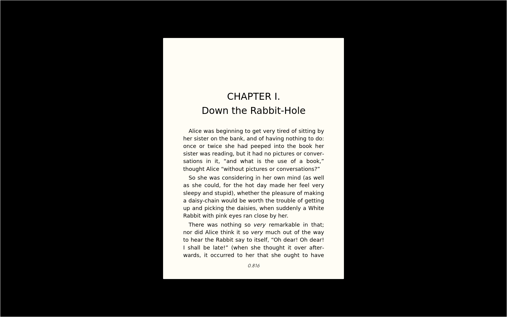
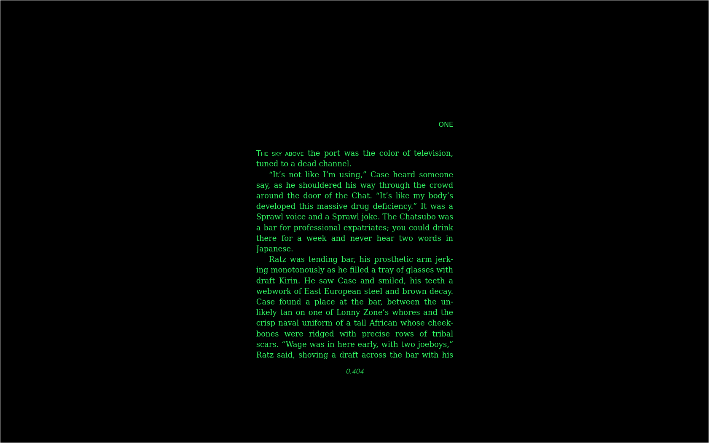

# SM reader

sm-reader.github.io

v 2026-11-11-11-10-04

Mirror of old MS (Microsoft) book reader, with white page on black background

Mobile and desktop.

To install PWA point your browser to https://sm-reader.github.io , and wait for "Install complete" message at the bottom. You can use the app offline afterwards, just recall that bookmark location.

Note that for app to work offline (without server), it has to be installed from http***s**, or localhost

You can also run your own server (`python3 -m http.server 7777`). Installing from localhost will keep it working offline (when you are not connected to server). Installing using ip address will not. 

On Linux/Chromium don't use double click to open import file, use 'Open file' button when importing books, doubleclick somehow auto fires 'Cancel' button.

Menu and position are hide-able.

"*A thing of beauty is a joy for ever ...*"

John Keats, Endymion

